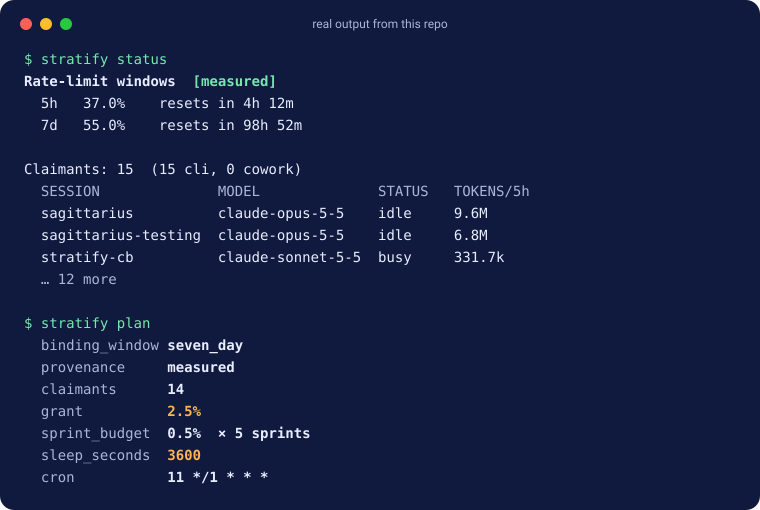

<h1 align="center"><em>nice</em>, for your rate limit.</h1>

<p align="center">
Every Claude session you run draws on one shared window.<br>
Stratify tells each session how much of it to take, and when to come back.
</p>

<p align="center"></p>

## What you get



`status` shows who is spending. `plan` turns that into one session's orders: a grant, a sprint size, a sleep, and a cron expression.

## Priority, the `nice` way

```bash
stratify claim --nice 10    # yield share to other sessions
stratify claim --nice -5    # take a larger share
```



## One machine, several accounts

Sessions on different accounts don't share a window, so they don't share a split. On Linux, stratify reads which credential each session was started with (from its process environment, or else its config directory's login) and plans each account separately. `status` adds an `ACCOUNT` column when it knows.

Credentials are hashed in memory. Only a short fingerprint like `api key ·3f2a` is ever kept or shown. Where an account can't be read, the session counts toward every split, as before.

## It says how sure it is

| `provenance` | Meaning | What the plan does |
|---|---|---|
| 🟢 `measured` | A live window, read recently | Full grant |
| 🟡 `estimated` | A live window read a while ago, or one that just reset | Full grant, labelled |
| 🔴 `UNKNOWN` | No current reading | One minimum sprint (0.5 %) at a slow cadence, never a full grant |

## Proved, not promised

The allocator is Lean 4 with exact integer arithmetic ([`lean/Stratify/Allocate.lean`](lean/Stratify/Allocate.lean)).

| | Theorem | Says |
|---|---|---|
| 1 | `grants_le_budget` | Grants never sum past the budget |
| 2 | `grant_mono` | Higher priority never costs you share |
| 3 | `grant_pos` | A fair share of at least 1 mpp gets a nonzero grant |
| 4 | `sleepFor_bounds` | Sleep always lies between 60 s and 1 h |
| 4b | `sprint_schedule_within_grant` | Every sprint together fits the grant |
| 6 | `budgetOf_rolledOver` | A window reset is safe |
| 7 | `unknown_is_bounded` | No reading means a bounded grant, not a full one |
| 8 | `expired_not_measured` | A reading from a past window is never called a measurement |

## Install

```bash
make install                # builds from source; needs the Lean toolchain in lean/lean-toolchain
stratify install-sensor     # prints the statusline change; modifies nothing
```

Applying the sensor edits `~/.claude/settings.json`, which affects every session, so the skill asks first. Without it, stratify still counts sessions and tokens but cannot see the window.

Then ask Claude to *work in stratified sprints*, or run `stratify plan` yourself.

```bash
make check                  # deterministic evals; see evals/README.md
```

## Layout

```
lean/        the binary and the proofs
skills/      the Claude Code skill that drives it
evals/       checks for the binary, and graded cases for the skill
docs/        one-page site (docs/index.html) and its figures
```
